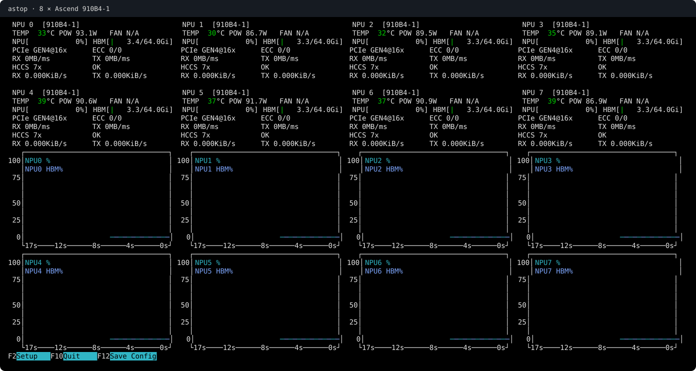

# astop — Ascend Top

**A read-only terminal monitor for Huawei Ascend NPUs, built in C with ncurses.**

See device activity, HBM usage, and running processes at a glance. astop is a lean,
Ascend-only adaptation of [nvtop](https://github.com/Syllo/nvtop), with live history
charts and JSON output for scripts.



*Rendered from a live terminal session with the process table hidden (`astop -P`).*

- **Device overview:** aligned device cards with NPU utilization, HBM usage,
  temperature, and power, plus PCIe, ECC, and HCCS link details when there is room.
- **History charts:** teal NPU activity and soft blue HBM occupancy, with
  configurable metrics and selected devices.
- **Process table:** sortable PIDs, users, device memory, host CPU and memory,
  and commands, subject to driver and Linux permissions.
- **Keyboard settings:** choose charts, columns, and devices; save your preferences.
- **Scriptable output:** take one JSON snapshot or stream successive snapshots.
- **Read-only operation:** observe workloads without process-kill or device-control actions.

## Requirements

| Purpose | Requirements |
| --- | --- |
| Run astop | Linux, an Ascend NPU, and a working Ascend driver installation exposing `libdcmi.so` and its dependent driver libraries |
| Runtime libraries | glibc, `libncursesw.so.6`, and `libtinfo.so.6`; Ubuntu packages: `libc6`, `libncursesw6`, `libtinfo6` |
| Interactive display | A terminal with a valid `TERM`; UTF-8 is recommended. 80 × 24 supports the compact overview; a wider/taller terminal shows more charts and detail |
| Build from source | C11 compiler, Make, pkg-config, and ncurses development headers; Git to clone the repository |
| Run live smoke checks | Python 3, tmux, and the validated eight-device 910B4-1 host described under [Compatibility and limits](#compatibility-and-limits) |

The validated target is **Ubuntu 24.04 ARM64 with Ascend driver 26.1.1**. The
binary built on this host references glibc 2.38 symbols and cannot run with an
older glibc; testing used glibc 2.39. This does not establish compatibility with
other distributions or driver versions.

On Ubuntu 24.04, the terminal runtime libraries can be installed with:

```sh
sudo apt install libncursesw6 libtinfo6
```

Install the Ascend driver separately and ensure your user can query the devices.
The driver libraries are supplied by the driver installation, not by astop.
CANN's development toolkit, Python, and tmux are not needed to run the monitor;
Python and tmux are used by the optional smoke checks. Snapshot modes (`-s`, `-l`)
do not require an interactive terminal.

## Quick start

You need Linux, a C compiler, Make, pkg-config, ncurses development files, and an
installed Ascend driver providing `libdcmi`. On Ubuntu:

```sh
sudo apt install git build-essential pkg-config libncurses-dev
git clone https://github.com/WingsOfPanda/astop.git
cd astop
make
./build/astop
```

To install for your user:

```sh
make install PREFIX="$HOME/.local"
export PATH="$HOME/.local/bin:$PATH"
astop
```

Add the `export` line to your shell startup file to keep it across sessions.
The build needs neither CMake nor an installed nvtop binary.

The default DCMI library directory is `/usr/local/Ascend/driver/lib64/driver`.
If your driver uses a different location, build with:

```sh
make DCMI_LIBDIR=/path/to/driver/lib64/driver
```

This directory is embedded in the binary's runtime library search path. If you
change it after building, run `make clean` before rebuilding with the new value.

## Usage

```sh
astop                  # interactive monitor; default refresh is one second
astop -d 5             # refresh every half-second (units: tenths of a second)
astop -P               # hide the process table
astop -p               # hide history charts
astop -i               # force link/ECC details and additional device clocks
astop -i -X            # include static specs and secondary clock domains
astop -C               # monochrome
astop -s               # one JSON snapshot
astop -l -d 10         # successive JSON snapshots every second
astop --help
```

| Key | Action |
| --- | --- |
| F2 | Configure charts, process columns, and selected devices |
| F6 | Choose the process sort column; Enter confirms |
| + / - | Sort ascending / descending |
| Arrow keys or h j k l | Navigate menus and scroll the process table |
| F12 | Save settings |
| Ctrl-L | Redraw |
| q | Quit |

All devices are selected on first launch. Settings live in
`$XDG_CONFIG_HOME/astop/interface.ini`, or `~/.config/astop/interface.ini` when
`XDG_CONFIG_HOME` is unset, independently of nvtop. Use `-c /path/to/interface.ini`
to load and save a different settings file.

### PCIe, ECC, and HCCS

Wide/tall terminals show link details on each device card automatically, using
nvtop's compact shape: the name and PCIe readings on the first line,
temperature/power/ECC/HCCS on the second, and NPU/HBM bars on the third. Cards
use fixed field widths and wrap into aligned columns instead of adding a
separate link-details block. Small terminals retain the compact overview;
`-i` requests the detailed view with primary clocks in the same metadata lines.
`-X` may add rows for optional static specifications.

- **PCIe:** current negotiated generation and lane width, plus driver-reported
  RX/TX bandwidth. The reference host currently negotiates Gen4 x16 even though
  its reported maximum is Gen5 x16.
- **ECC:** corrected / uncorrected totals from the memory types the driver can
  query. Unsupported readings are `N/A`, not zero.
- **HCCS:** configured interconnect link count, health, and aggregate RX/TX
  throughput. The reference host reports seven links per NPU. These are Ascend
  HCCS links; NVIDIA NVLink version labels do not apply.

HCCS rates use differences between 64-bit traffic counters and monotonic elapsed
time, with the documented 20 bytes per counter unit. Rates use KiB/s, MiB/s, or
GiB/s; an initial or failed sample has no rate. This avoids a blocking bandwidth
profiling call on each NPU. See the [Ascend HCCS counter documentation](https://www.hiascend.com/doc_center/source/zh/HDK/2610/A2/A2npu/npusmi_0075.html).

PCIe bandwidth retains the driver's native integer **MB/ms** units ([DCMI API reference, section 2.103](https://www.hiascend.com/doc_center/source/zh/Atlas%20200I%20A2/24.1.0/re/api/Atlas%20A2%20%E6%99%BA%E8%83%BD%E8%BE%B9%E7%BC%98%E7%A1%AC%E4%BB%B6%2024.1.0%20DCMI%20API%E5%8F%82%E8%80%83.pdf#page=198)) and is sampled
periodically (currently every five seconds). It does not offer NVML-like fine
resolution. The existing PCIe load plots retain upstream binary scaling as an
estimate; the driver's decimal-versus-binary bandwidth scale has not been verified.

## JSON snapshots

`astop -s` writes a JSON array of devices, including processes unless `-P` is set.
For example, inspect device IDs and utilization with Python 3:

```sh
astop -s -P | python3 -c 'import json, sys; print([(d["device_id"], d["npu_util"]) for d in json.load(sys.stdin)])'
```

- `device_id` is numeric; `pci_bus_id` identifies the device's PCI address.
  Device IDs stay consistent when selecting a subset in the interface.
- Many measurements are strings: utilization such as `"50%"`, clocks such as
  `"1800MHz"`, and memory byte counts such as `"68719476736"`.
- Unavailable metrics are `null`. A successful query with no devices returns `[]`.
- PCIe/ECC/HCCS fields are numeric (or `null`), with `hccs_healthy` boolean (or
  `null`). PCIe bandwidth keys end in `_mb_per_ms`; HCCS throughput keys end in
  `_bytes_per_second` so scripts can keep the units explicit.
- `astop -l` emits successive, formatted JSON arrays. It is neither JSON Lines
  nor one enclosing JSON document; consume it with a streaming JSON decoder.

## Compatibility and limits

The following configuration has been validated:

| Component | Validated configuration |
| --- | --- |
| OS / architecture | Ubuntu 24.04 / ARM64 |
| Devices | 8 × Ascend 910B4-1 |
| Memory | 64 GiB HBM per device |
| Ascend driver | 26.1.1 |

Other models, architectures, and driver versions have not been validated.
Metric availability depends on successful DCMI queries: missing readings show
`N/A` in the interface or `null` in JSON, and missing history samples leave gaps.
The Ascend collector supplies process IDs and device-memory usage, but **does not
provide per-process NPU utilization**. Host CPU and memory readings come from
Linux process information.

## Development

```sh
make test              # focused core, history, layout, and empty-device checks
make smoke             # live hardware and terminal integration checks
```

The checks require the build prerequisites above. `make smoke` also needs Python 3,
tmux, and the eight-device 910B4-1 reference configuration. It exercises snapshots,
terminal resizing, controls, and saved device selection using temporary settings.
It does not start workloads or signal existing workload processes.

## Troubleshooting

- **`astop: command not found`:** add `~/.local/bin` to `PATH`, or run
  `~/.local/bin/astop` directly.
- **Cannot link or load `libdcmi`:** check that the Ascend driver is installed and
  `DCMI_LIBDIR` points to its library directory; clean and rebuild after changing it.
- **Too little room for the interface:** enlarge the terminal, use `-P` to hide
  processes, or `-p` to hide charts. Wider terminals leave more room for detail.

## License and attribution

astop derives from nvtop commit
[`71094a9`](https://github.com/Syllo/nvtop/commit/71094a9f7dfbfe7cbe9faebfdf055e580a034283)
and retains its applicable copyright notices and **GPLv3-or-later** licensing.
See [LICENSE](LICENSE), [NOTICE](NOTICE), and the
[nvtop source reference](docs/nvtop-reference.md). DCMI declarations retain Huawei's
Apache-2.0 notices; bundled INI and hash-table code retain their own licenses.

This is an independent project, not an official Huawei product.
